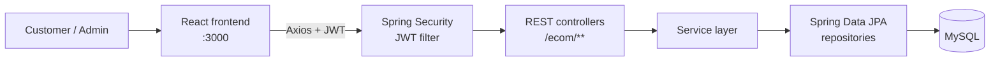
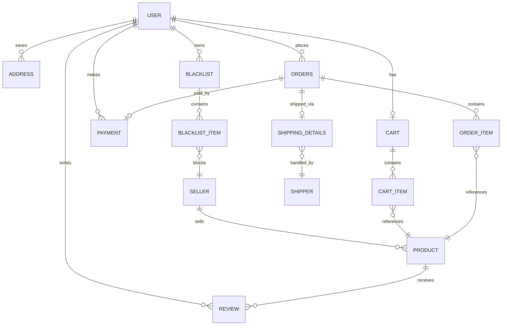

<div align="center">

# 🛒 E-Commerce Web App

**A full-stack online store with a customer storefront and an admin dashboard, built with React, Spring Boot and MySQL.**


</div>

---

## Table of Contents

- [Overview](#overview)
- [Features](#features)
- [Architecture](#architecture)
- [Tech Stack](#tech-stack)
- [Data Model](#data-model)
- [Project Structure](#project-structure)
- [Getting Started](#getting-started)
- [Authentication](#authentication)
- [API Reference](#api-reference)
- [Future Work](#future-work)
- [Author](#author)

---

## Overview

This project is a complete e-commerce platform with two kinds of users:

- **Customers** browse and search the catalog, manage a cart, save addresses, place orders, pay, and review products.
- **Administrators** manage the product catalog, customers, orders and shippers from a dedicated dashboard.

A standout feature is the **seller blacklist**: customers can block sellers they don't want to buy from, and the backend automatically hides those sellers' products from that customer's view of the catalog.

## Features

### 🛍️ Customer

- Register, sign in and manage a profile
- Browse products with a rotating home-page carousel of categories
- **Search** by product name or seller, **filter** by category, and **sort** by price
- Product detail pages with **reviews** (add, edit, delete)
- Shopping cart: add, remove, change quantities, empty cart
- Save and edit shipping addresses
- Place orders, make a payment, and view order history
- **Blacklist sellers** to hide their products from your catalog
- Update password or deactivate your account

### 🛠️ Admin

- Separate admin login, restricted to accounts with `ROLE_ADMIN`
- Add, update and delete products (sellers are created automatically from the seller name)
- View all customers, view details and edit their accounts
- View all orders, or orders placed on a specific date
- Manage shippers and assign shipping to orders

### 🔐 Platform

- Stateless authentication with **JWT** and **Spring Security**
- Passwords hashed with **BCrypt**
- Role-based access control on every endpoint (`ROLE_USER` / `ROLE_ADMIN`)
- Request validation and a global exception handler with consistent error responses
- Interactive API documentation with **Swagger UI**

## Architecture



The backend follows a classic layered design: **Controller → Service → Repository → Entity**, with DTOs separating API payloads from database entities.

## Tech Stack

| Layer | Technologies |
|---|---|
| Frontend | React 18, React Router 6, Axios, jwt-decode, Font Awesome, Create React App |
| Backend | Java 21, Spring Boot 3.3, Spring Web, Spring Data JPA (Hibernate), Bean Validation, Lombok |
| Security | Spring Security, JWT (jjwt 0.11), BCrypt |
| Database | MySQL |
| Docs & tooling | springdoc-openapi (Swagger UI), Maven Wrapper |

## Data Model



**Enumerations**

| Enum | Values |
|---|---|
| `UserRole` | `ROLE_ADMIN`, `ROLE_USER` |
| `OrderStatus` | `PENDING`, `SHIPPED`, `DELIVERED`, `CANCELED` |
| `PaymentStatus` | `PENDING`, `SUCCESSFUL`, `FAILED` |
| `PaymentMethod` | `CASH`, `CREDIT_CARD`, `UPI` |
| `UserAccountStatus` | `ACTIVE`, `DEACTIVETE` |

## Project Structure

```
E_commerce-web-app/
├── eCommersApp/                   # Spring Boot backend
│   ├── pom.xml
│   └── src/main/
│       ├── java/Ecom/
│       │   ├── Controller/        # REST endpoints
│       │   ├── Service/           # Service interfaces
│       │   ├── ServiceImpl/       # Business logic
│       │   ├── Repository/        # Spring Data JPA repositories
│       │   ├── Model/             # JPA entities
│       │   ├── ModelDTO/          # Request/response DTOs
│       │   ├── Enum/              # Roles and statuses
│       │   ├── Exception/         # Custom exceptions + global handler
│       │   └── SecurityConfig/    # Security chain, JWT filter, CORS
│       └── resources/
│           └── application.properties
└── frontend/                      # React frontend
    ├── package.json
    └── src/
        ├── pages/                 # Home, Product, Cart, Payment, Admin, Blacklist, ...
        ├── components/            # Navbar, Slider, admin tables and forms, ...
        ├── Router/                # Routes, protected route, Axios instance
        ├── comp_css/              # Component styles
        └── picture/               # Category images
```

## Getting Started

### Prerequisites

- **Java 21**
- **Node.js** 16+ and npm
- **MySQL** 8 running locally

### 1. Clone the repository

```bash
git clone https://github.com/bestebayhan04/E_commerce-web-app.git
cd E_commerce-web-app
```

### 2. Create the database

```sql
CREATE DATABASE my_db;
```

Tables are created automatically on first run (`spring.jpa.hibernate.ddl-auto=update`).

### 3. Configure the backend

Edit `eCommersApp/src/main/resources/application.properties`:

```properties
spring.datasource.url=jdbc:mysql://localhost:3306/my_db
spring.datasource.username=your_mysql_user
spring.datasource.password=your_mysql_password
```

> ⚠️ Keep real passwords and the JWT signing key out of version control. Prefer environment variables, e.g. `spring.datasource.password=${DB_PASSWORD}`.

### 4. Run the backend

```bash
cd eCommersApp
./mvnw spring-boot:run          # Windows: mvnw.cmd spring-boot:run
```

The API starts at **http://localhost:8080**. Swagger UI is available at **http://localhost:8080/swagger-ui/index.html**.

### 5. Run the frontend

```bash
cd frontend
npm install
npm start
```

The app opens at **http://localhost:3000**.

### 6. Create an admin account

Admin accounts are created through the API:

```bash
curl -X POST http://localhost:8080/ecom/admin \
  -H "Content-Type: application/json" \
  -d '{ "firstName": "Admin", "lastName": "User", "email": "admin@example.com", "password": "Admin123", "phoneNumber": "5550000000" }'
```

Passwords must be 5–10 characters and phone numbers at least 10 digits. Then sign in at `/admin-login`.

## Authentication

1. The client calls `GET /ecom/signIn` with **HTTP Basic** credentials.
2. On success, the server returns a signed **JWT** in the `Authorization` response header. The token carries the user's role and is valid for about 8 hours.
3. The frontend stores the token and sends it in the `Authorization` header of every request through an Axios interceptor.
4. `JwtTokenValidatorFilter` validates the token on each request, and Spring Security enforces role rules per endpoint.
5. The UI decodes the token to route admins and customers to the right views.

## API Reference

All endpoints are prefixed with `/ecom`. Full, interactive documentation is available in Swagger UI.

<details>
<summary><b>Auth & Users</b></summary>

| Method | Endpoint | Access | Description |
|---|---|---|---|
| `GET` | `/signIn` | Authenticated | Sign in and receive a JWT |
| `POST` | `/customers` | Public | Register a customer |
| `GET` | `/customers/{customerId}` | User | Get a customer |
| `GET` | `/customers/get-all-customer` | Authenticated | List all customers |
| `PUT` | `/customers/update/{customerId}` | Authenticated | Update customer details |
| `PUT` | `/customers/update-password/{customerId}` | Authenticated | Change password |
| `DELETE` | `/customers/deactivate/{customerId}` | Authenticated | Deactivate an account |
| `DELETE` | `/customers/delete/{customerId}` | Authenticated | Delete an account |
| `POST` | `/admin` | Public | Create an admin |
| `PUT` | `/admin/updatepassword/{adminId}` | Admin | Change admin password |

</details>

<details>
<summary><b>Products, Sellers & Reviews</b></summary>

| Method | Endpoint | Access | Description |
|---|---|---|---|
| `GET` | `/products/all` | Public | List products |
| `GET` | `/products/{productId}` | Public | Get a product |
| `GET` | `/products/category/{category}` | Public | Products in a category |
| `GET` | `/products/product-By-name/{name}` | Public | Search by name |
| `POST` | `/products/add` | Admin | Add a product |
| `PUT` | `/products/update/{productId}` | Admin | Update a product |
| `DELETE` | `/products/{productId}` | Admin | Delete a product |
| `GET` | `/sellers/all` | Authenticated | List sellers |
| `GET` | `/product-reviews/{productId}` | Public | Reviews for a product |
| `POST` | `/product-reviews/{productId}/{userId}` | User | Add a review |
| `PUT` | `/product-reviews/{reviewId}` | User | Edit a review |
| `DELETE` | `/product-reviews/{reviewId}` | Admin | Delete a review |

</details>

<details>
<summary><b>Cart, Orders & Payments</b></summary>

| Method | Endpoint | Access | Description |
|---|---|---|---|
| `POST` | `/cart/add-product` | User | Add a product to the cart |
| `GET` | `/cart/products/{cartId}` | Authenticated | View the cart |
| `PUT` | `/cart/increase-productQty/{cartId}/{productId}` | User | Increase quantity |
| `PUT` | `/cart/decrease-productQty/{cartId}/{productId}` | User | Decrease quantity |
| `DELETE` | `/cart/remove-product/{cartId}/{productId}` | User | Remove a product |
| `DELETE` | `/cart/empty-Cart/{cartId}` | Authenticated | Empty the cart |
| `POST` | `/orders/placed/{userId}` | User | Place an order from the cart |
| `GET` | `/orders/orders/{userId}` | Authenticated | A user's orders |
| `GET` | `/orders/{orderId}` | Authenticated | Get an order |
| `GET` | `/orders/all` | Authenticated | All orders |
| `GET` | `/orders/date/{date}` | Authenticated | Orders by date |
| `DELETE` | `/orders/users/{userId}/{orderId}` | Public | Cancel an order |
| `POST` | `/order-payments/makePayment` | Authenticated | Pay for an order |

</details>

<details>
<summary><b>Addresses, Shipping & Blacklist</b></summary>

| Method | Endpoint | Access | Description |
|---|---|---|---|
| `GET` | `/customer-addresses/{userId}` | Authenticated | List addresses |
| `POST` | `/customer-addresses/{userId}` | User | Add an address |
| `PUT` | `/customer-addresses/update/{addressId}` | User | Update an address |
| `DELETE` | `/customer-addresses/delete/{addressId}` | Admin | Delete an address |
| `GET` | `/order-shippers` | Authenticated | List shippers |
| `POST` | `/order-shippers/add` | Admin | Add a shipper |
| `DELETE` | `/order-shippers/{id}` | Admin | Remove a shipper |
| `POST` | `/order-shipping/{orderId}/{shipperId}` | User | Assign shipping to an order |
| `PUT` | `/order-shipping/{shippingId}` | User | Update shipping details |
| `GET` | `/blacklist/{userId}` | Authenticated | A user's blacklisted sellers |
| `POST` | `/blacklist/add-seller` | Authenticated | Blacklist a seller |
| `DELETE` | `/blacklist/remove-seller/{blacklistId}/{sellerName}` | Authenticated | Remove a seller from the blacklist |

</details>

## Future Work

- Integrate a real payment provider (payments are currently simulated and always succeed)
- Move secrets (DB password, JWT key) to environment variables
- Restrict admin registration and customer-list endpoints to admins only
- Pagination for product and order lists
- Image upload instead of image URLs
- Unit and integration tests for services and controllers

## Author

**Beste Bayhan** ([@bestebayhan04](https://github.com/bestebayhan04))
